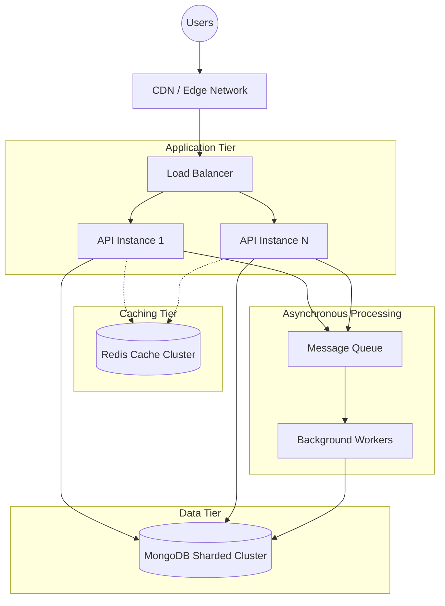

# System Design: ShelfLife Library Management System

This document outlines the system design for ShelfLife, scaling up to support 500 campus libraries, approximately 2 million members, and 10x normal traffic during the first week of every semester.

## 1. High-Level Architecture

The system utilizes a modern, scalable architecture designed for high availability and low latency.



### Components:
- **CDN**: Caches static frontend assets (React app) and global static content, reducing load on origin servers.
- **Load Balancer**: Distributes incoming HTTP requests across multiple Node.js API instances to ensure no single instance is a bottleneck.
- **API Instances**: Stateless Node.js applications that process business logic. They can be scaled horizontally during traffic spikes.
- **Redis Cache**: Serves as a distributed cache to store frequently accessed, read-heavy data (e.g., book catalog search results).
- **MongoDB Sharded Cluster**: The primary data store, utilizing sharding to distribute the dataset and workload.
- **Message Queue & Workers**: Used for non-critical, asynchronous tasks like sending notifications, generating analytics, and processing daily overdue audits.

## 2. MongoDB Scaling & Sharding Strategy

With 2 million members and millions of borrow records across 500 libraries, a single MongoDB replica set may struggle with the working set memory and write throughput. Sharding is recommended.

### Shard Keys

**Book Collection**
- **Option 1**: `{ libraryId: 1, _id: 1 }` (Assuming multi-tenant/library support is added). This ensures all books for a specific library are stored on the same shard, optimizing query locality when users browse their specific campus library.
- **Option 2 (Current Scope)**: `{ genre: 1, _id: 1 }`. If libraries are combined, a compound key on genre and `_id` provides good distribution for targeted searches. However, `{ _id: 1 }` alone (hashed) is safer to prevent hotspots if genre distribution is highly skewed.
- **Recommendation**: Hashed `_id` for uniform distribution of writes and reads, or `{ libraryId: 1, _id: 1 }` if data locality per campus is required.

**BorrowRecord Collection**
- **Shard Key**: `{ member: 1, issueDate: 1 }`.
- **Reasoning**: This provides excellent data locality. When a member views their history, all their records are likely to be contiguous and on the same shard. The `issueDate` provides monotonically increasing entropy for new records, but since it's prefixed by `member`, we avoid a single "hot" shard for all new inserts.

## 3. Caching Strategy

The most read-heavy operation is querying the book catalog, particularly `GET /api/books` with pagination, genre, and title filters.

### Implementation
- **What is cached**: Paginated search and filter results.
  - Example Cache Key: `books:genre:programming:title:clean:page:1:limit:20`
- **TTL (Time to Live)**: 15 to 30 minutes, depending on the volatility of the library catalog.
- **Invalidation Strategy**: Cache-aside with targeted invalidation.
  - When a book is added, updated, issued, or returned, the availability changes.
  - Due to the complexity of paginated queries, an event-driven "tag-based" invalidation or simply clearing the `books:*` namespace for the specific campus library is most practical when a copy's availability changes.
  - Alternatively, cache only the book metadata and fetch real-time availability in a separate, lightweight query or merge it at the API layer.

## 4. Concurrency Control

A critical requirement is ensuring `availableCopies` never becomes negative, especially when two librarians attempt to issue the last copy simultaneously.

### Strategy: Atomic Conditional Updates

We use MongoDB's document-level locks and atomic operators to enforce consistency without needing complex distributed application-level locks.

```javascript
// Issue Book Operation
const updatedBook = await Book.findOneAndUpdate(
  {
    _id: bookId,
    availableCopies: { $gt: 0 } // Critical condition
  },
  {
    $inc: { availableCopies: -1 } // Atomic decrement
  },
  { new: true }
);

if (!updatedBook) {
  throw new Error("Book is not available or does not exist");
}
```

### Why this is preferable:
- **vs. Application-level locks**: Node.js is single-threaded per process, but in a multi-instance (horizontally scaled) environment, memory locks fail.
- **vs. Distributed Redis locks**: Adds unnecessary network overhead and complexity for a simple counter update.
- **vs. Optimistic Locking (Version numbers)**: Works well, but the `$inc` with a conditional match is simpler and highly performant for counter-based concurrency.

## 5. Handling 10x Traffic Spikes

The first week of every semester generates a massive 10x traffic spike.

### Autoscaling & Infrastructure
- **Horizontal Pod Autoscaling (HPA)**: API instances run in Kubernetes (or AWS ECS) and automatically scale based on CPU utilization and request queuing time. We do not over-provision year-round; the system dynamically expands.
- **Database Connection Pooling**: Ensure API instances share connections efficiently. Autoscaling too many API instances can exhaust MongoDB connections, so a proxy (like MongoS) or careful max-pool tuning is required.
- **Read Scaling**: Direct heavy read queries (like catalog browsing) to MongoDB secondary nodes to keep the primary node free for critical writes (issuing/returning books).

### Throttling & Graceful Degradation
- **Rate Limiting**: Implemented at the API Gateway/Load Balancer to prevent abuse.
- **Asynchronous Processing**: Non-essential tasks (analytics, heavy reporting, notification generation) are moved to the Message Queue. During spikes, the queue may grow, but the synchronous issue/return workflows remain fast.
